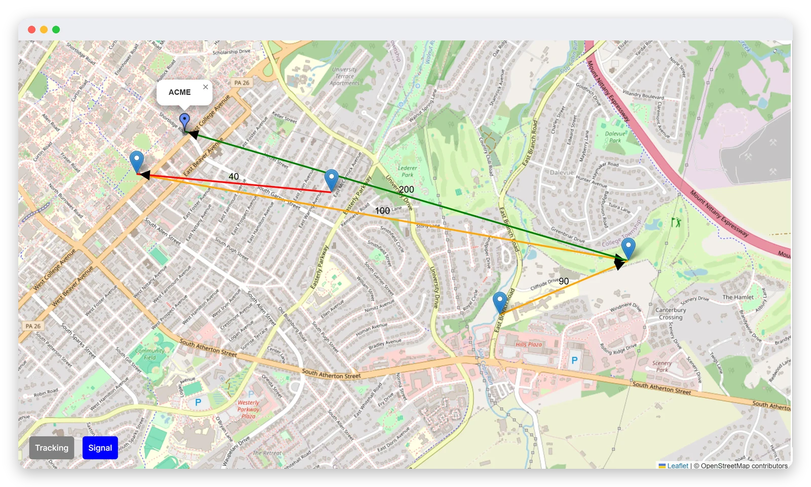
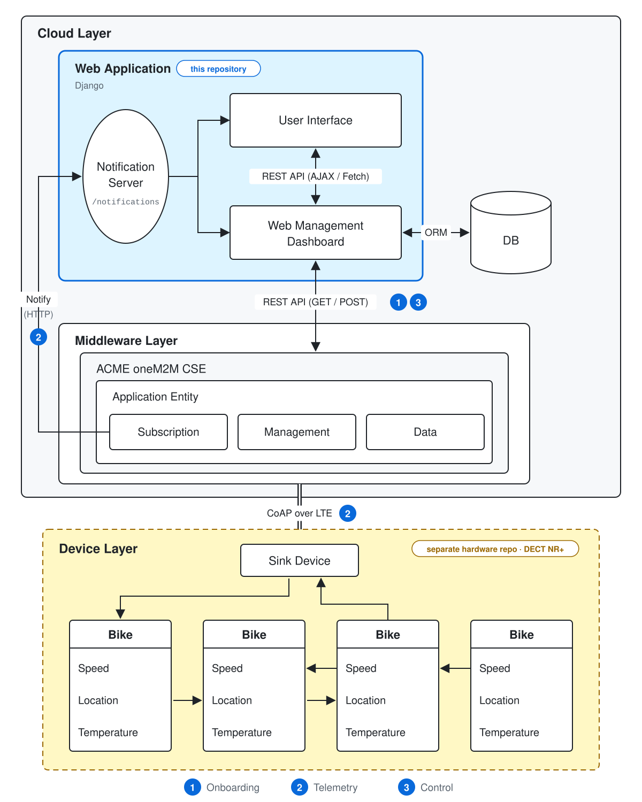
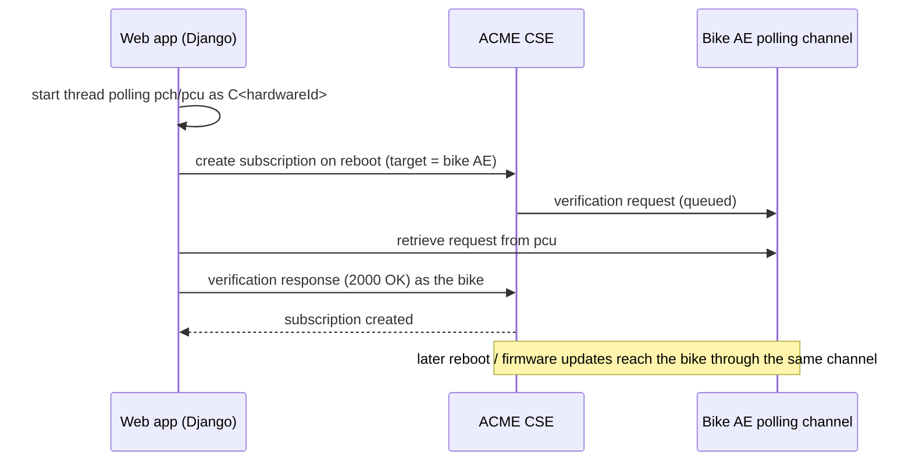
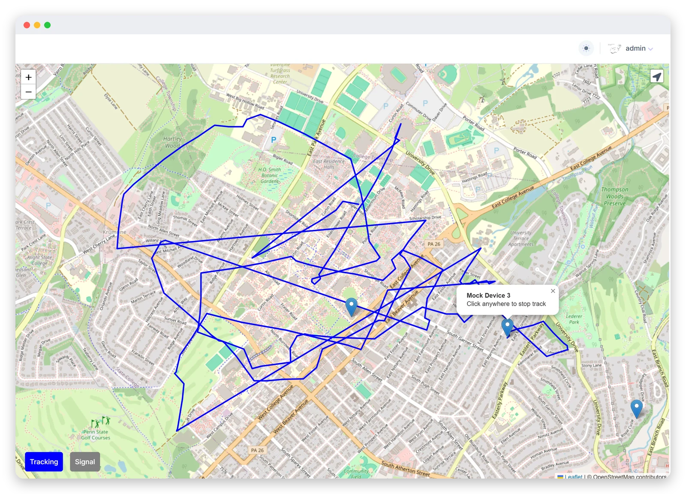
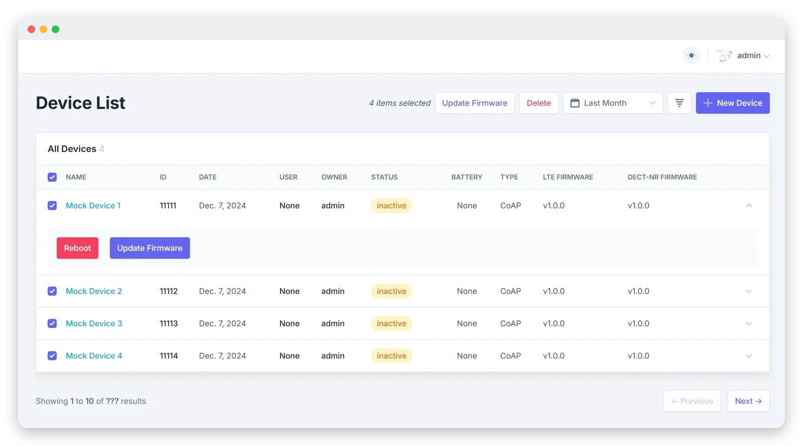
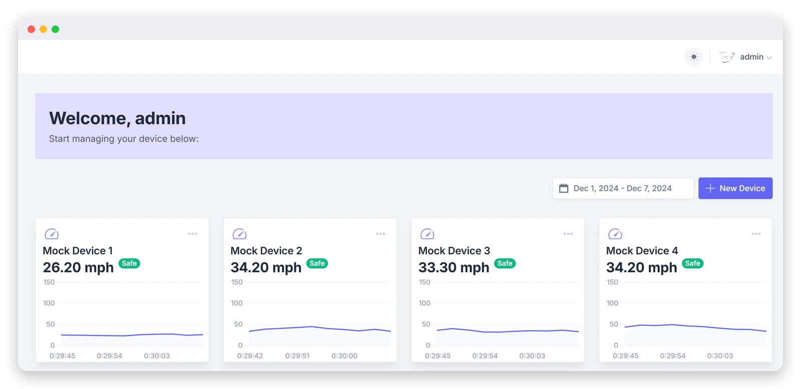
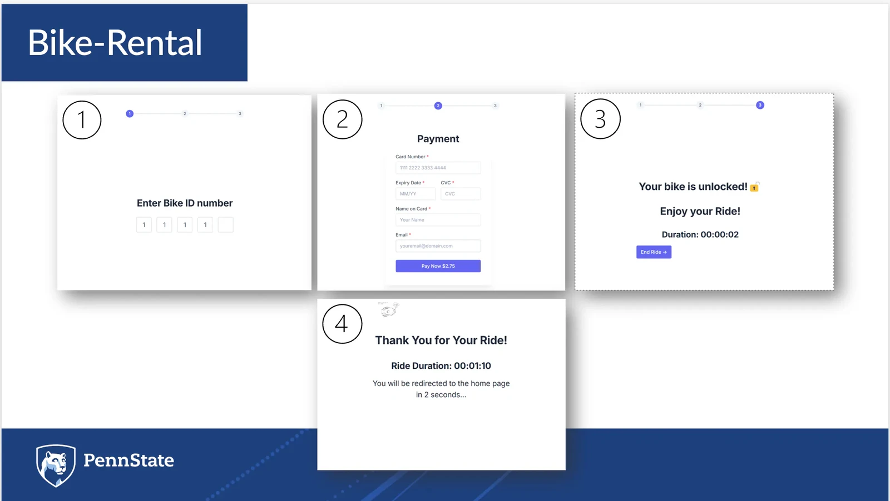
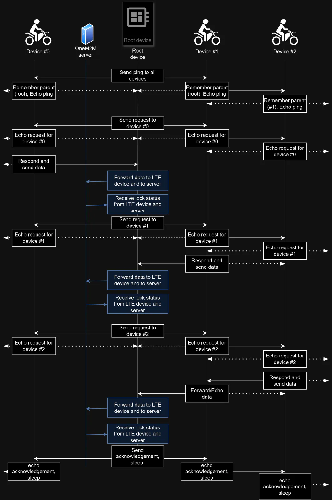
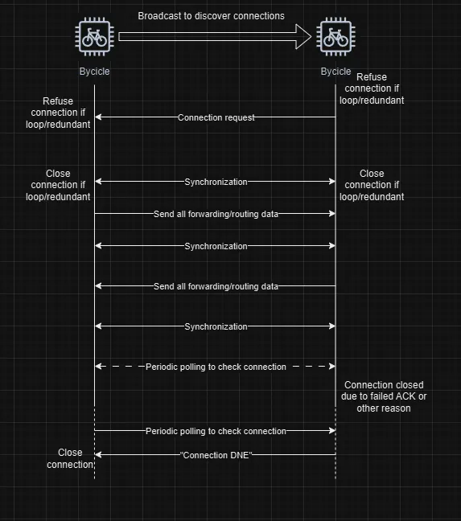

<div align="center">

# BikeShare IoT Platform

**The cloud side of a cellular + DECT NR+ bike-sharing system, built on the oneM2M IoT standard.**<br>
Operators onboard, monitor and remotely manage bikes. Riders unlock them from the browser.

[](https://www.linkedin.com/pulse/onem2m-2024-international-hackathon-judges-awards-onem2m-5xnse/)
[](https://www.hackster.io/psu-capstone-iot-project-fall-2024/bike-share-system-with-cellular-based-iot-and-onem2m-49bc4c)


**[Features](#features) · [Architecture](#architecture) · [Screenshots](#screenshots) · [My Role](#my-role) · [Setup](#setup)**



</div>

> [!NOTE]
> Historical prototype from Fall 2024. The hardware has been retired and the cloud deployment shut down. Screenshots show mock data.

A team project at Penn State: bikes carry nRF9161 boards that form a DECT NR+ mesh, and a sink device relays their data to an ACME oneM2M server over LTE. **This repository is the web platform on top of that:** a Django application that registers every bike as oneM2M resources, turns device notifications into live maps and charts, and sends lock, reboot and firmware commands back down to the hardware.

I designed the overall system architecture and the mesh protocol, built this web application and its oneM2M integration, and led the team to first place. Firmware lives in the [hardware repository](https://github.com/BobFIV/PSU_CAPSTONE_F24).

## Features

- 🛠️ **Device onboarding** · adding a bike creates its whole oneM2M footprint: node, application entity, data modules and subscriptions. [①](#architecture)
- 📡 **Telemetry monitoring** · location, speed and temperature notifications land in a live table and per-bike speed charts. [②](#architecture)
- 🗺️ **Location & route tracking** · live positions on a map, plus the full stored path of any bike. [②](#architecture)
- 🕸️ **Mesh visualization** · parent links and signal values reported by the mesh, drawn on the map and as a graph. [②](#architecture)
- 🔧 **Remote device control** · reboot a bike, or push LTE and DECT NR+ firmware to one or many bikes. [③](#architecture)
- 🚲 **Rental workflow** · enter a bike ID, pass a simulated payment, unlock, ride with a timer, lock on return. [③](#architecture)
- 🧪 **Mock data mode** · simulate bike movement from inside the app, for demos and testing without hardware.

## Architecture

<picture>
  <source media="(prefers-color-scheme: dark)" srcset="docs/assets/architecture-dark.svg">
  
</picture>

Three paths connect the browser to the bikes:

**① Onboarding.** Saving a `Device` fires a signal that builds the bike's resources in ACME: a `<node>`, an application entity with a polling channel, `lock` / `bikeData` / `meshConnectivity` / `battery` modules, and subscriptions that point back at this app. The web app also registers itself as an application entity and re-checks that registration every 10 minutes. → [`register_device_ae`](apps/management/onem2m_service.py#L84)

**② Telemetry.** Bikes report through the mesh to the sink, which forwards to ACME over CoAP. ACME notifies `/notifications` over HTTP; Django parses each module into its own model. The browser never talks to ACME: maps, tables and charts poll Django's JSON endpoints, and the mesh view uses long polling so it redraws only when new mesh data arrives. → [`receive_notification`](apps/management/views.py#L118)

**③ Control.** Unlocking, locking, rebooting and firmware updates are `PUT`s to the bike's oneM2M resources. Cellular bikes can't accept incoming requests, so reboot and firmware actions reach them through subscriptions on their polling channel. → [`send_reboot_command`](apps/management/views.py#L397)

<details>
<summary><b>Design highlight · the oneM2M resource tree created per bike</b></summary>

```text
CSE
├── ae_<hardwareId>                 application entity (originator C<hardwareId>)
│   ├── pch                         polling channel
│   ├── lock              cod:lock     ← web writes lock state
│   ├── bikeData          bdm:bikDt    ← bike reports location, speed, temperature
│   ├── meshConnectivity  bdm:msCoy    ← bike reports mesh parent and signal
│   └── battery           cod:bat      ← bike reports battery level
│       (each module: sub_<module> → this app's /notifications)
└── nod_<hardwareId>                node
    └── flexNode
        ├── dmAgent
        │   └── reboot                      → notifies the bike via pch
        ├── dmFirmware_lte
        │   └── updateFirmware              → notifies the bike via pch
        └── dmFirmware_dectnr
            └── updateFirmware              → notifies the bike via pch
```

`bdm:*` types come from the custom bike domain model in [`init/`](init/); module short names are mapped in [`constant/mapping.py`](constant/mapping.py).

</details>

<details>
<summary><b>Design highlight · creating subscriptions for an unreachable device</b></summary>

oneM2M verifies a new subscription by contacting its notification target. A bike behind LTE can't receive that request, so the web app answers it on the bike's behalf through the bike's polling channel, letting onboarding finish without any manual step. → [`create_subscription_with_pch_verification`](apps/management/onem2m_service.py#L284)



</details>

## Screenshots

_Recorded from the Fall 2024 prototype with mock data._



**Route history.** Every `bikeData` notification is stored as a `DeviceData` row; selecting a bike replays its stored positions as a path. ②

<table>
<tr>
<td width="50%"></td>
<td width="50%"></td>
</tr>
<tr>
<td valign="top"><b>Remote management.</b> Reboot a bike, or push LTE / DECT NR+ firmware to a batch of bikes, through their oneM2M management resources. ③</td>
<td valign="top"><b>Live speed.</b> Each chart asks only for readings newer than its last point, so the dashboard stays light. ②</td>
</tr>
</table>



**Rider flow.** A 5-digit bike ID, a simulated payment step, then the app writes `lock = false` to the bike; ending the ride locks it again and closes the ride record. ③

## My Role

I led the team, designed the system, and built the whole web side. Hardware teammates implemented the boards and firmware.

| Area | What I did | Where |
| --- | --- | --- |
| System design | Designed the cloud / middleware / device architecture and the DECT NR+ mesh protocol; wrote most of the Hackster article and drew its architecture and protocol diagrams | [Architecture](#architecture), diagrams below |
| oneM2M integration | Modeled each bike as an AE, a node and flexContainer modules; automated resource, subscription and polling-channel setup; kept the web app registered as its own AE | [`onem2m_service.py`](apps/management/onem2m_service.py), [`mapping.py`](constant/mapping.py), [`init/`](init/) |
| Telemetry pipeline | Built the `/notifications` endpoint, per-module parsing into models, and the JSON endpoints behind the dashboard | [`management/views.py`](apps/management/views.py), [`widgets/`](apps/widgets/) |
| Operator dashboard | Device management, map with tracking and signal views, mesh graph, speed charts, live log, firmware library | [`templates/`](templates/), [`static/js/`](static/js/) |
| Remote control | Lock and unlock, reboot, single and batch firmware updates through oneM2M | [`update_device_firmware`](apps/management/views.py#L299), [`update_lock_module`](apps/management/onem2m_service.py#L549) |
| Rider experience | Four-step rental flow with ride records and a live timer | [`home/`](apps/home/) |
| Testing & integration | Integrated the web app with ACME and the hardware team's boards; added mock movement for testing without hardware | [`mock/`](apps/mock/) |

<details>
<summary><b>Mesh protocol diagrams</b> (my design; implemented in firmware by the hardware team)</summary>
<br>



**Initial mesh protocol.** The root device polls each bike in turn; requests and responses are echoed along the tree, and the root exchanges data and lock status with the oneM2M server over LTE.



**Connection setup.** Bikes discover each other by broadcast, refuse loops or redundant links, exchange routing data, and close connections that stop answering.

</details>

## Repository Guide

| Path | Contents |
| --- | --- |
| [`apps/management/`](apps/management/) | Device and firmware models, oneM2M service, notification endpoint, remote commands, AE keep-alive scheduler |
| [`apps/widgets/`](apps/widgets/) | Telemetry models (`DeviceData`, `MeshConnectivity`, `Battery`), map, log and mesh pages, JSON endpoints |
| [`apps/home/`](apps/home/) | Rider flow and `Ride` records |
| [`apps/auth/`](apps/auth/) | Login, registration and password reset |
| [`apps/mock/`](apps/mock/) | Simulated bike movement |
| [`constant/mapping.py`](constant/mapping.py) | oneM2M module short names and default attributes |
| [`init/`](init/) | Custom bike domain model (`bdm`) definitions for ACME |
| [`core/`](core/) | Settings, URL routing, `superuser_required` decorator |
| [`templates/`](templates/), [`static/`](static/) | Server-rendered pages (Tailwind, Alpine.js) with Leaflet, D3 and Chart.js |

## Setup

<details>
<summary><b>Run it locally</b> (not re-verified since the deployment was retired)</summary>
<br>

**Requirements**

- Python 3.10+ (Django 5.1)
- A reachable [ACME](https://github.com/ankraft/ACME-oneM2M-CSE) oneM2M CSE with the definitions from [`init/`](init/) copied into its `init` directory
- A public URL for this app, so ACME can deliver notifications to `/notifications`

**Configure:** copy [`.env.example`](.env.example) to `.env` and replace the `xxxx` placeholders:

```ini
# Public URL of this app with an explicit port; used for allowed hosts, CSRF and the notification URL
SERVER_URL=http://<public-host>:<port>
ONE_M2M_CSE_URL=http://<acme-host>:<port>/<cse-name>
SECRET_KEY=<django-secret-key>
```

**Run**

```bash
git clone https://github.com/WindHurtLZ/Bike-Share-IoT-Platform.git
cd Bike-Share-IoT-Platform
python -m venv venv && source venv/bin/activate
pip install -r requirements.txt
python manage.py makemigrations   # migration files are not tracked
python manage.py migrate
python manage.py createsuperuser  # superusers get the operator dashboard
python manage.py runserver
```

Regular accounts land in the rider flow. Without hardware, each request to `/simulate-device-movement/` moves every registered bike one step.

The [Hackster article](https://www.hackster.io/psu-capstone-iot-project-fall-2024/bike-share-system-with-cellular-based-iot-and-onem2m-49bc4c) walks through the original AWS and ACME setup step by step.

</details>

## Credits & References

- **Award:** [oneM2M Judges' Awards announcement](https://www.linkedin.com/pulse/onem2m-2024-international-hackathon-judges-awards-onem2m-5xnse/), 1st Place at the 4th oneM2M International Hackathon (2024)
- **Build article:** [Bike Share System with Cellular-Based IoT and oneM2M](https://www.hackster.io/psu-capstone-iot-project-fall-2024/bike-share-system-with-cellular-based-iot-and-onem2m-49bc4c) on Hackster, covering cloud setup, ACME, hardware and testing
- **Hardware and firmware:** [BobFIV/PSU_CAPSTONE_F24](https://github.com/BobFIV/PSU_CAPSTONE_F24), built by the hardware team
